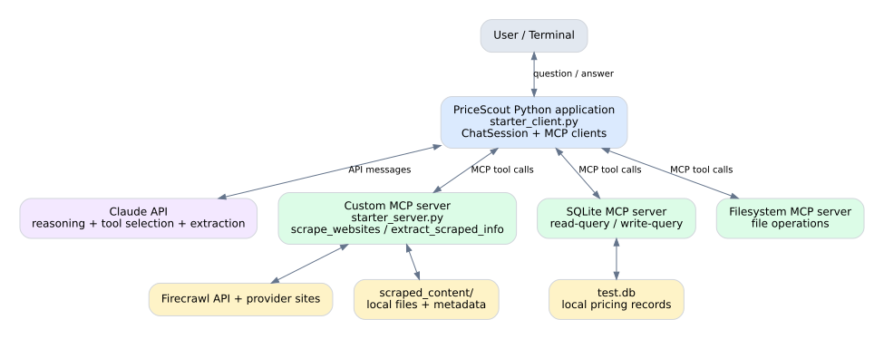
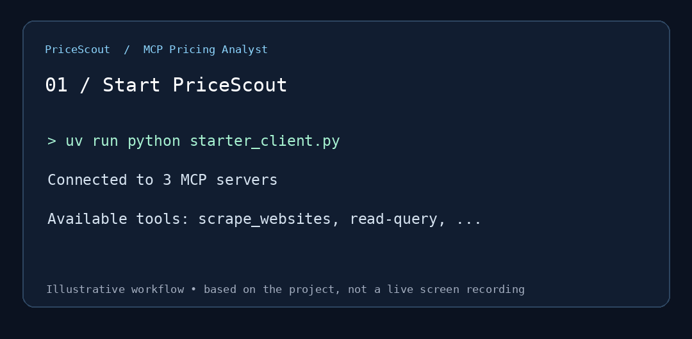

# PriceScout — Agentic LLM Pricing Analyst

**Portfolio case study | Udacity MCP learning project | Documentation-only repository**

PriceScout is a command-line prototype that helps compare **LLM inference pricing** across providers. It combines a custom Model Context Protocol (MCP) scraper, Claude-based tool selection and extraction, local scraped artifacts, and SQLite-backed price lookup.

> **Source-code publication:** This is a public-facing technical case study, **not** a source-code distribution. The implementation was completed in a Udacity course environment using course starter files. Those files and their modified derivatives are intentionally not published here while redistribution rights are unconfirmed. This repository is not intended to be cloned and run as an application.

## Architecture

The Python command-line host coordinates Claude API messages and MCP client sessions. Three MCP servers provide access to (1) custom website scraping, (2) SQLite queries, and (3) filesystem operations. The custom scraper uses Firecrawl to fetch provider pages and save artifacts. An extraction component turns scraped text into structured pricing records, which are stored and queried through SQLite.

## Demo — illustrated workflow

**Note:** This animation is an *illustration*, not an actual screen recording or proof of a live run. No personal terminal screenshots or credentials are published.

## What the project does

1. Connects a command-line assistant to three MCP servers and discovers available tools.
2. Uses a custom MCP scraping tool to collect pricing-page content from supported providers.
3. Saves scraped text and associated metadata locally for later retrieval.
4. Uses an LLM extraction step to structure model names and input/output token prices.
5. Stores structured pricing rows in SQLite and retrieves them for comparisons.
6. Answers comparison questions from available records and explicitly acknowledges missing prices.
7. Provides a command to display the five most recently stored pricing records.

## Example use case

**Question:** *Compare DeepInfra and CloudRift prices for DeepSeek V3.*

**Expected workflow:** Retrieve relevant stored rows, compare available input/output token pricing, and say when a provider/model combination lacks a verified stored price. The prototype does not guarantee live or complete pricing coverage.

## Tools and technologies

| Technology | Role |
|---|---|
| Python | Command-line application, orchestration, extraction logic |
| Model Context Protocol (MCP) | Standardized client/server tool integration |
| Claude API | Natural-language reasoning, tool selection, data extraction |
| Firecrawl | Retrieval of pricing-page content |
| SQLite | Persistent local storage of structured pricing |
| Filesystem MCP server | File operations |

## My learning and implementation focus

This project was developed as part of guided coursework, with assistance in coding and debugging. My focus was on understanding and validating the end-to-end architecture, integrating custom scraping with multiple MCP servers, testing the workflow, inspecting stored price comparisons, and iterating based on reviewer feedback. It is presented as a **course project**, not an independently built commercial product.

**Technical design decisions demonstrated:**

- Separate the host/client orchestration from the scraping tool server.
- Persist source artifacts and structured records instead of relying on one-off answers.
- Reuse stored records for comparisons where possible.
- Preserve uncertainty when an exact price is unavailable.
- Keep credentials and generated local data out of a public portfolio.

## Validation and scope

The coursework submission included evidence of connecting three MCP servers, scraping provider pricing pages, reading stored pricing for a comparison, and displaying stored rows. Reviewer feedback identified a display limit issue; the query was corrected to show the latest **5** rows. This repository does not contain those original screenshots because they included local terminal context.

This was a learning prototype; it has not been independently audited or deployed as a production service. Prices and provider pages can change.

## Next improvements

- Add unit tests with mocked MCP calls and extraction results.
- Add refresh caching using scraped metadata timestamps.
- Build a FastAPI service and lightweight web interface.
- Add price-history comparison and change notifications.
- Rebuild a clean-room open-source version if the original coursework license does not permit sharing code.

## Privacy and publication

No course starter code, modified course source, `.env`, API keys, local database, scraped data, or personal screenshots are included. Please check the Udacity course terms before publishing implementation code or course assets elsewhere.
